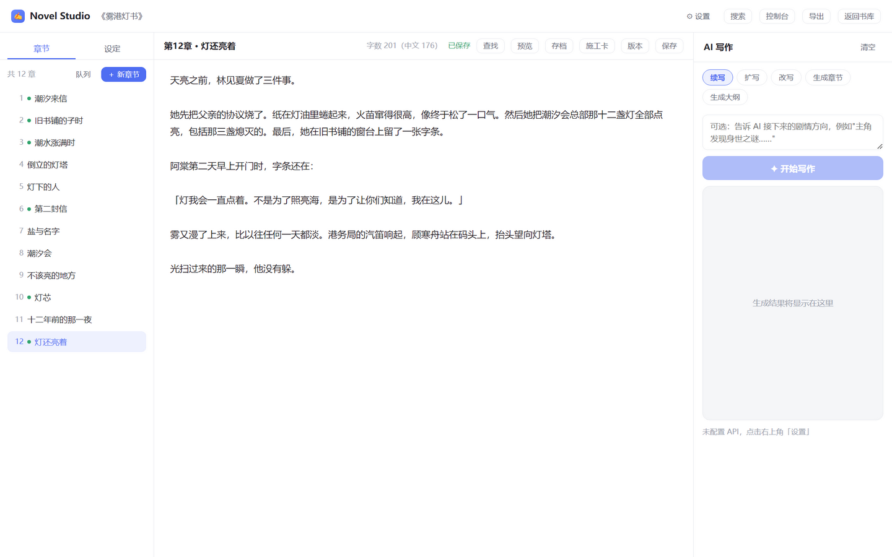
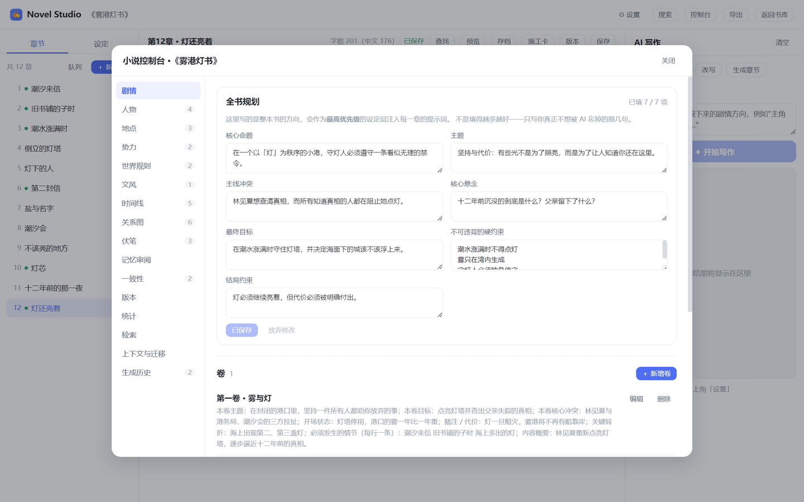
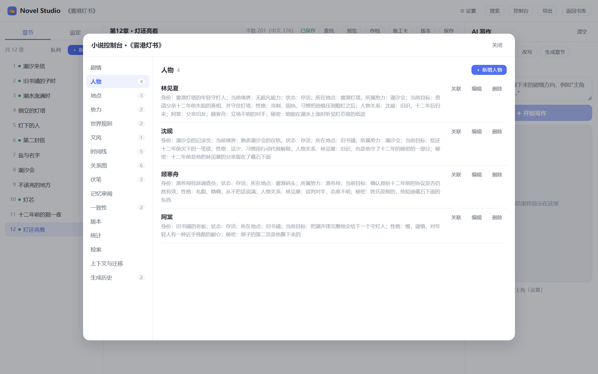
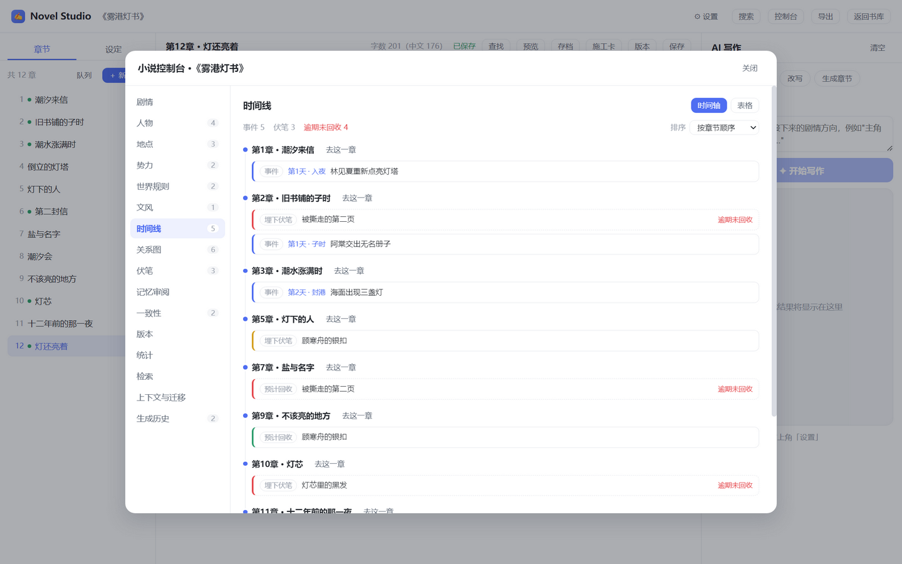
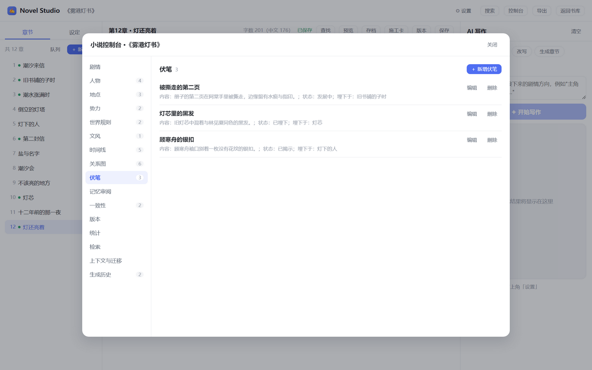
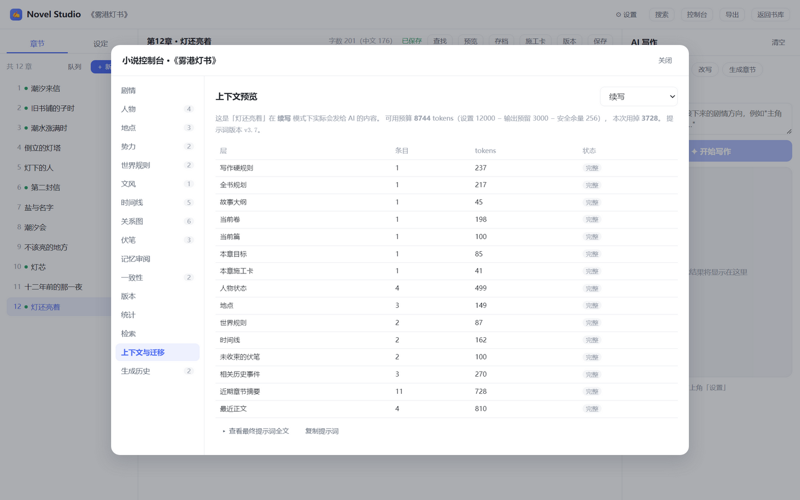

# Novel Studio · 长篇小说的 AI 写作工作台

[](LICENSE)
[](https://nodejs.org)
[](https://vuejs.org)
[](https://www.electronjs.org)
[](#)

一款**本地优先**的长篇小说 AI 写作工作台，连接任意 OpenAI 兼容接口（DeepSeek / Kimi / 通义 / GLM / OpenAI…）。

它不是「把光标丢给模型续一段」，而是给长篇写作补上模型最缺的那样东西——**记忆**：人物状态、关系、世界规则、地点、势力、时间线、事件与伏笔都以结构化数据保存，每写完一章由 AI 提取变更、按风险分级入库，成为下一章的前提。写第 300 章时 AI 依然知道第 3 章埋下的伏笔。

- **Windows**：双击即可运行的独立 exe（安装版 / 便携版）
- **浏览器**：`npm run dev` 打开 localhost 即可使用
- **Android**：同一套代码，已配好工具链，可直接产出 APK

数据默认保存在本机 IndexedDB，软件本身不提供云端存储、没有账号体系、没有埋点。**调用 AI 时，相关的正文与设定上下文会发送给你自己配置的那个 API 服务**——这是使用 AI 的必然前提，请自行确认所选服务商的隐私政策。此外不做任何外发。

电脑与手机之间可以在**同一个局域网内直连同步**（见下方专节）：数据只在两台设备之间传输，不经过任何第三方服务器。

## 下载

到 [**Releases**](https://github.com/whitefemale/novel-studio/releases/latest) 页面下载：

| 平台 | 文件 | 说明 |
|---|---|---|
| Windows | `Novel-Studio-Setup-*.exe` | 安装版，可选安装目录、建桌面与开始菜单快捷方式 |
| Windows | `Novel-Studio-Portable-*.exe` | 便携版，单文件双击即用、不写注册表，适合放 U 盘 |
| Android | `Novel-Studio-Android-*-release.apk` | 手机安装包（**已签名 release**，可直接覆盖升级） |

> ⚠️ Windows 安装包**没有做代码签名**，首次运行会弹「Windows 已保护你的电脑」。
> 这是 SmartScreen 对未知发布者的默认拦截，不是杀毒软件报毒——点「更多信息」→「仍要运行」即可。
> Android 包已用本项目的 release keystore 签名（未上架商店，系统仍可能提示「未知来源」）。

> **Android release 包允许明文 HTTP**（局域网同步、本机 Ollama、内网 LLM 端点都需要）。
> 这意味着同一网络里的其他人可能看到请求内容**包括 API Key**。公网服务请一律用 `https://`，
> 并避免在公共 Wi-Fi 下使用 `http://` 端点。

> 软件本身不带 API Key，第一次打开要先在「设置」里填接口地址 / API Key / 模型名。
> 也可以在服务商下拉里选预设（DeepSeek / OpenAI / Kimi / 智谱 GLM / 通义千问 / SiliconFlow / 本机 Ollama），
> 地址与建议模型会自动填好。默认 `https://api.deepseek.com`，任何 OpenAI 兼容接口都能用。

<p align="center">
  
  
</p>
<p align="center">
  
  
</p>
<p align="center">
  
  
  
</p>

> 截图由 `npm run screenshots` 用 Electron 真实渲染生成（临时 `userData`，不碰你的数据），
> 演示内容为虚构小说《雾港灯书》。

## 功能

### 长篇剧情

| 功能 | 说明 |
|---|---|
| 剧情层级 | 卷 / 篇 / 章 / 场景四级骨架，各有目标、冲突、高潮与状态；控制台「剧情」标签里维护 |
| 全书规划 | 核心命题、主题、主线冲突、核心悬念、最终目标、硬约束与结局约束；会作为最高优先级的设定层进入提示词 |
| 章节施工卡 | 每章可写视角人物、开场状态、核心冲突、必须发生、禁止出现、状态变化、结尾钩子、验收标准与目标字数；可标「临时计划 / 已确认」，生成后自动核对目标与禁发项 |
| 生成前计划校验 | AI 给出的计划在采用前会被确定性检查：已死人物出场、覆灭势力复活、时间线倒挂、核心规则被改写、伏笔提前揭示、偏离卷篇必发节拍、与近章重复；每条都带原文证据，**可显式覆盖**，也永不阻断你手工编辑 |
| 人物关系图 | 控制台「关系图」：以人物与势力为节点，画出首领、隶属、事件共现、盟友/敌对与自由文本关系；手写 SVG、无图表库，布局确定、可点开详情 |
| 当前章节记忆 | 重开一本书会回到上次编辑的那一章；删章时自动回退到相邻章。指针按独立时间戳同步，不会因为翻页把整本书标成「更新过」 |
| 时间线可视化 | 「时间线」标签有竖轴与表格两种视图：轴上按章节排事件，**伏笔的埋点与预期回收点同样上轴**，逾期未回收用警示色标出，点节点直接跳到那一章 |
| 一致性检查 | 「一致性」标签打开即算（共 12 条规则）：断链引用、时间线倒挂、伏笔逾期、已死角色仍在出场、重复事件、章节缺摘要、记忆陈旧、主线长期未推进等，**纯计算、不调用 AI、不产生费用**；需要更细的可以手动点「AI 深检」，费用照常计入生成历史 |
| 审校闭环 | 深检报告里的每条问题都有生命周期（待处理 / 已接受 / 已忽略 / 已修复 / 复核失败）；可对单条问题生成**定向修复稿**，先看差异再决定是否写回，**绝不自动覆盖正文** |
| 章节版本历史 | AI 覆盖正文 / 手动存档 / 回滚 / 删章这四个时刻自动留版，可展开读全文、一键恢复；支持**任意两版对比**（逐行标出增删）与「复制为草稿」；**回滚本身可撤销**，误删的章节也能从版本里恢复成新章 |
| 小说控制台 | 全屏弹窗，左侧标签分栏：剧情 / 人物 / 地点 / 势力 / 世界规则 / 文风 / 时间线 / 伏笔 / 记忆审阅 / 一致性 / 版本 / 统计 / 上下文与迁移 / 生成历史 |

### 小说记忆

| 功能 | 说明 |
|---|---|
| 结构化人物 | 身份、性格、背景、目标、秘密、当前位置与所属势力、**当前境界**、状态（存活/死亡/失踪）、关系 |
| 世界与势力 | 世界规则（含优先级与例外）、地点（含层级与当前状态）、势力（目标、资源、领袖、敌友、状态） |
| 时间线与伏笔 | 事件按章节顺序排成时间线；伏笔记录埋下章、预期回收章、当前状态与揭示含义 |
| 自动提取 | 每写完一章，AI 提取其中的状态变化并写回记忆库——**低风险直接入库，高风险进审阅队列** |
| 记忆审阅 | 人物死亡、境界倒退、势力覆灭、世界规则改动这类会改变后续每一章前提的变更，逐条列出 `原值 → 新值` 待你确认 |
| 旧设定迁移 | 已有小说里的「人物设定 / 世界观」可一键升级为结构化实体；**原设定一字不改**，不开控制台则完全看不出变化 |

### AI 工作流

| 功能 | 说明 |
|---|---|
| 写 + 提取 | 默认档：写正文 → 提取记忆两步；可在设置里关掉自动提取 |
| 服务商预设 | DeepSeek / OpenAI / Kimi / 智谱 GLM / 通义千问 / SiliconFlow / 本机 Ollama / 自定义，一键填入地址与建议模型；切换预设**不会清掉已填的 API Key**，Ollama 允许空 Key |
| 写作队列 | 侧栏「队列」：把多章排好队，逐章生成草稿，可暂停 / 继续 / 取消 / 重试；**只出草稿、不自动改正文**，插入或存为新章都由你确认；重启后中断的条目不自动重跑 |
| 本地检索（RAG） | 开启后从全书已写正文里按字面相似度召回相关片段，作为「相关历史片段」一层进入提示词；256 维哈希向量、零新依赖、默认关闭，控制台「检索」页可看覆盖率、重建索引与试跑查询 |
| 多模型分工 | 写作 / 提取 / 审校 / 规划 / 大纲可各用一个模型（例如正文用好模型、提取用便宜的）；留空则回退到统一定义的模型 |
| 文风档案 | 视角、时态、句式节奏、对白比例、词汇倾向、禁用表达、人物语气与腔调样本；控制台「文风」标签维护，启用后压缩成一层进入提示词（样本只取前 300 字，避免挤占正文上下文） |
| 提示词组装 | 上下文由 Context Builder 按优先级分层组装（写作规则 → 全书规划 → 卷篇目标 → 章节施工卡 → 场景 → 人物状态 → 地点 → 时间线 → 伏笔 → 文风 → 近期摘要 → 最近正文 → 你的临时要求），**由代码决定装什么，不交给模型** |
| Token 预算 | 默认 6000 tokens 预算；必带的层永不截断，其余按优先级分配，装不下的层会被丢弃并**如实告诉你** |
| Context Preview | 摊开「这一章 AI 实际会看到什么」：每层的 token 数、是否被截断/丢弃，以及最终提示词的全文 |
| 花费预算 | 单次调用与每日累计两个上限，可设「只提示」或「必须点继续」；**价格未知时明确写「价格未知」，绝不显示成 ¥0** |
| 失败重试 | 网络错误、超时、429 与 5xx 会自动退避重试（最多 2 次），401/403/400/404 不重试；**已经收到正文后绝不自动重试**，避免重复计费与拼接错乱 |
| 崩溃草稿恢复 | 流式生成过程中每隔 1.5 秒把已收到的文字存一次；崩溃、关窗或 Android 杀后台后重新打开书，可把中断前的草稿载入输出框、插入正文或丢弃 |
| Token 与金额 | 每次调用后显示本次花费（输入/输出 tokens 与金额），可展开看分阶段明细 |
| 生成历史 | 控制台里按**每次调用**列出（阶段、章节、模型、tokens、金额、提示词版本、上下文摘要），并给出合计 |
| 记忆审阅队列 | 高风险变更的待办清单，逐条显示 `原值 → 新值`；可批量采纳低风险项，也可撤销最近一次记忆变更 |

> 金额按「设置 → 价目表」计算，价目表可编辑且**默认值仅供参考**——各服务商定价时常调整，
> 请以官方定价页为准。端点没返回用量时按字符估算并标注「估」。

### 写作与数据

| 功能 | 说明 |
|---|---|
| 书库管理 | 多部小说卡片、新建/删除/编辑（书名 / 简介 / 封面配色）、关键词搜索与排序 |
| 章节管理 | 侧边栏目录、增删改、上下排序；目录按 100 章分页「加载更多」，跳到远处的章节会自动展开到它 |
| 编辑器 | 纯文本编辑 + Markdown 预览、实时字数统计、1.5 秒防抖自动保存（Ctrl/Cmd+S 立即保存）；保存中 / 已保存 / **保存失败（可重试）** 三态如实可见，不会永远停在「保存中」 |
| 生命周期冲刷 | 切到后台、关闭窗口、Android 切到后台时，防抖窗口里还没落盘的文字会先写库；Electron 关窗会等渲染层确认后再退出 |
| 全书搜索 | 顶栏「搜索」：在当前书的正文、旧设定与全部结构化实体里找，结果显示命中片段与跳转；↑↓ 选择、Enter 打开、Esc 关闭。点实体直接打开控制台对应标签 |
| 查找替换 | Ctrl/Cmd+F 打开查找栏，支持上一个/下一个/替换/全部替换（纯字面量匹配） |
| 写作统计 | 控制台「统计」标签：卷 / 篇 / 章完成度、字数与目标进度、主线与支线推进、人物出场频率与缺席、伏笔回收率与逾期清单、事件密度。每项都标注统计口径，**数字只描述本机数据，不评价文学质量** |
| AI 续写 | 从当前章节末尾自然衔接；走编排器，因此**每章都带记忆、都记花费** |
| AI 扩写 / 改写 | 选中正文中的文字，AI 扩写或润色，一键替换/插入；这两种模式刻意不改动记忆库 |
| 生成大纲 | 根据书名与创意点生成完整分章大纲，存入设定 |
| 生成章节 | 依据故事大纲与记忆库生成一章正文，可直接存为新章节 |
| 设定管理 | 故事大纲 / 人物设定 / 世界观，自动注入 AI 提示词（**多条大纲会全部注入**） |
| 全量备份 | 书库页「备份」：整库导出为单个 `.json`，带版本号与校验和；恢复时**合并**而非覆盖，先告诉你会新增/覆盖/删除各多少条，并自动保留一份「恢复前快照」；也可以「作为副本导入」而不碰现有书 |
| 局域网同步 | 电脑与手机连同一个 Wi-Fi 即互相补齐（见下方专节）；**不经过第三方服务器，也不传 API Key**；同一章两端都改过时保留**冲突副本**，不静默覆盖正文 |
| WebDAV 同步 | 不在同一局域网时，用自己的 WebDAV 服务器（坚果云 / Nextcloud / 群晖等）作为中转（见下方专节）；每台设备一个快照文件，合并规则与局域网同步完全一致；服务器密码只存在系统安全存储里，**不进备份、不进快照、不打日志** |
| 声明式插件 | 往插件目录放 JSON，就能追加写作规矩、禁用词检查、导出模板与关键词提示；**只读取声明，绝不执行插件代码**，不联网、不碰密钥与文件 |
| 导出 | 整本或单章导出 TXT / Markdown；可设置保存地址直写，也可每次弹保存框；装了插件模板时可选用模板导出 |
| 自动备份 | 按设定间隔把整本小说备份到 `保存地址/书名/备份/`，自动淘汰超出保留份数的旧备份 |
| API 设置 | Base URL、API Key、模型名、按任务分模型、温度、最大 Token、上下文策略、价目表、花费预算 |
| 密钥安全 | **桌面版**把 API Key 交给 Electron `safeStorage` 加密保存（Windows 走系统凭据加密），IndexedDB 里不再留明文；浏览器与 Android 没有同等安全存储，仍以明文存在本机 IndexedDB，界面会如实提示 |

## 快速开始

需要 **Node.js 18 或更高版本**。浏览器模式与 Electron 打包在 18 上即可；
**Android 构建需要 22 或更高**（见下方 Android 章节）。

```bash
git clone <你的仓库地址>
cd novel-studio
npm install
```

```bash
npm run dev          # 浏览器开发模式 → http://localhost:5173
npm run electron     # 桌面版运行（先 build 再用 Electron 加载产物）
npm run dist:win     # 打包 Windows 安装版 + 便携版 → release/
```

> 仓库自带的 `.npmrc` 已把 registry 与 Electron 二进制指向 npmmirror 国内镜像，
> 国内网络下 `npm install` 可以直接装上 Electron（约 100MB）。若你不在国内，
> 删掉 `.npmrc` 即可走官方源。

首次使用请点击右上角「设置」填写：
- **接口地址**：如 `https://api.deepseek.com`（DeepSeek / Kimi / 通义 / GLM / OpenAI 等任何 OpenAI 兼容接口均可）
- **API Key**：你的密钥
- **模型名**：如 `deepseek-chat`

然后「测试连接」验证，即可开始写作。

## 使用流程

1. 「新建小说」填写书名与一句话简介
2. 左侧「章节」新建章节，或直接点「生成大纲」
3. 右侧「AI 写作」选择续写/扩写/改写等，可选填写创作要求，点「开始写作」
4. 生成结果流式显示，点「插入正文」「替换选中」或「存为新章节」
5. 「设定」页维护大纲、人物、世界观，AI 会参考这些设定写作
6. 想一次补多章草稿时，点侧栏「队列」批量入队（**只出草稿，不碰正文**）
7. 随时「导出」为 TXT / Markdown；装了插件模板的话还可以按模板导出

> **重开一本书会回到上次编辑的那一章**，不用每次自己翻回去。
> 服务商可以在「设置 → AI 接口」的下拉里一键切换，已填的 API Key 不会被清掉。

> **书库默认按「最近更新」排序**（此前是按新建顺序倒排）。可在书库顶部切换到「创建时间」或「书名」。

## 长篇写作怎么用

V1 里 AI 能看到的只有「最近几章 + 几段扁平设定」，写到几十万字必然自相矛盾。V2 的做法是把记忆交给结构化的数据库：

1. 打开一本小说，点顶栏「**控制台**」。
2. 在「剧情」里建卷与篇，在「人物 / 地点 / 势力 / 世界规则」里先立好主要设定（也可以什么都不建，让 AI 从正文里提取）。
3. 切到「**上下文与迁移**」看一眼 Context Preview：确认这一章 AI 会拿到什么、有没有哪一层被预算挤掉。
4. 回编辑器，用「**生成章节**」或「续写」写正文。写完后：
   - 面板上会显示**本次花掉的 token 与金额**；
   - AI 顺手提取本章记忆：低风险的直接入库，高风险的进「记忆审阅」等你确认。
5. 下一章生成时，人物状态、时间线、伏笔已经自动带上——不需要你每次手动复述。
6. 写累了切到「**一致性**」看一眼：断链引用、伏笔逾期未回收、已死角色仍在出场这类问题会自己冒出来（**不花钱**）；「**版本**」里留着每一版正文，AI 覆盖掉你满意的那版也能找回来。
7. 想在手机上接着写：见下方「局域网同步」——两边写的会互相补齐，不是谁覆盖谁。

已有小说（V1 数据）不需要做任何事：旧「设定」侧栏照旧可用，控制台会提示「发现 N 条旧设定可升级」，点了才升级，且**原设定内容一字不改**。

## 小说控制台

| 标签 | 作用 |
|---|---|
| 剧情 | 全书规划、卷与篇的骨架、场景与章节施工卡；点卷 / 篇 / 场景可看到归属关系 |
| 人物 / 地点 / 势力 / 世界规则 | 结构化记忆库，可手建可编辑；列表里显示的那行文字与送给 AI 的**完全相同**；点「关联」可展开这个人物 / 地点 / 势力出现过的事件、伏笔与章节 |
| 关系图 | 人物与势力组成的网络：首领、隶属、事件共现、盟友 / 敌对与自由文本关系；可过滤、点节点看详情，点击跳到对应人物 |
| 文风 | 视角、时态、句式节奏、对白比例、词汇倾向、禁用表达、人物语气与腔调样本；`active` 的那份进入提示词 |
| 时间线 | 事件按章节顺序排列（而不是按你录入的时间）；可切到竖轴视图，伏笔的埋点与回收点也在轴上 |
| 伏笔 | 埋下章 / 预期回收章 / 状态（已埋下 → 发展中 → 已揭示 → 已收束） |
| 记忆审阅 | 高风险变更的待办，逐条显示 `原值 → 新值`，采纳或忽略；低风险项可撤销 |
| 一致性 | 规则算出的问题清单，每条可跳转；问题状态会保留，可对单条问题生成定向修复稿（先看差异再接受）；规则部分不花钱，需要更细的可手动「AI 深检」 |
| 版本 | 按章节分组的历史版本，显示时间 / 来源 / 字数与**与当前正文的字数差**，可恢复、两版对比、复制为草稿 |
| 统计 | 完成度、字数、主线 / 支线推进、人物出场、伏笔回收率与事件密度；每项标注口径 |
| 检索 | 本地检索索引的覆盖率、分块数、重建 / 清除，以及查询试跑；文案明确「字面相似，不是语义模型」 |
| 上下文与迁移 | Context Preview（每层 token / 截断 / 丢弃 + 最终提示词全文，可复制提示词）、旧设定一键升级 |
| 生成历史 | 按每次调用列出阶段、章节、模型、tokens、金额、提示词版本与上下文摘要（行可展开） |

窄屏（手机）下控制台整屏铺满、标签栏变成顶部横向可滚动条。

## 局域网同步（电脑 ↔ 手机）

**两台自己的设备直连，不是云同步。** 电脑上开一个只监听本机局域网的服务，手机直接连过来，
中间没有中转服务器，作者也看不到你的任何数据。因此它与「本地优先、不提供云端存储」并不矛盾。

怎么用：

1. **电脑端**（Windows 版）：设置 →「局域网同步」→ 勾上「开启同步服务」。首次会弹 Windows
   防火墙授权，**必须选「允许访问」**。
2. 面板上会列出本机的局域网地址（可能有多条——VPN、虚拟机网卡也会出现）与一个 **6 位配对码**。
   挑手机能连上的那个地址，点「复制」。
3. **手机端**：同一条 Wi-Fi 下，在「局域网同步」里填电脑地址（照抄刚才那行，如 `192.168.1.5:8787`）
   与配对码，先点「测试连接」，再点「立即同步」。
4. 完成后会显示**新增 / 覆盖 / 删除各多少条**。

几条需要知道的行为：

- **是「互相补齐」，不是「用一方覆盖另一方」。** 两边独有的内容都会保留。
  **在一台上删掉的东西也会同步过去**（删除靠墓碑记录传播），不会「删了又复活」——
  这是同步里最容易做错的地方，也是这套实现重点保证的一条。
- **同步的是内容，不是设置。** API Key、接口地址、价目表**永远不会**随同步传出去。
- **默认关闭，每次开启换码。** 不在设置里主动打开就不会有任何监听。配对码只存在电脑内存里，
  不落盘、不写日志；连错 10 次会锁定一分钟，点「换一个配对码」可立即解锁。
- **只在局域网可达**，不做端口映射、不对外网开放。换到公共 Wi-Fi（咖啡馆、酒店）时建议先关掉。
- **同一章在两台设备上都被改过时，不覆盖正文，而是保留冲突副本。** 较新的一版留在原章，
  另一版变成标题带「【冲突副本】」的新章，并在设置面板标出「待处理冲突 N」；
  重复同步不会重复生成副本。这个行为默认开启，可在设置里关掉，但**不建议**。
- **电脑正在生成正文时会拒绝同步**（提示稍后重试）。合并与流式写入会抢同一份数据，挡住它比丢稿好。
- **两端版本必须一致。** 数据格式版本不同时同步会明确拒绝并提示把两台设备升级到同一版本，
  而不是做「只懂一半」的合并。备份恢复允许读旧格式，但拒绝比本机更新的格式。
- 数据接近 64 MB 时会被电脑端拒绝，此时改用书库页的「全量备份」手工搬一次。

> **建议**：第一次同步前先做一次「全量备份」。那是同步出问题时唯一能整库回退的东西。
> 同一份数据在两台设备上各有一份明文副本，所以别把手机随便交给别人。

## WebDAV 同步（跨网络的多设备）

局域网同步要求两台设备在同一个 Wi-Fi。异地写作时，可以用**你自己的** WebDAV 服务器
（坚果云、Nextcloud、群晖、Alist 等）当中转：数据仍然只经过你选的服务器，不经过本项目的任何云。

怎么用（桌面端）：

1. 设置 →「WebDAV 同步」：填服务器地址、用户名、密码（密码写入系统安全存储，**不落 IndexedDB**）。
2. 点「测试连接」。远程目录不存在时会自动创建。
3. 点「立即同步」，或打开「自动同步」按设定间隔运行。

行为与边界：

- **每台设备一个快照文件**（`<远程目录>/<deviceId>.json`），同步时逐个拉取其他设备、
  用与局域网同步**完全相同**的合并规则合并，再上传自己的结果。
- **同一章两端都改过时仍保留冲突副本**，不静默覆盖正文；重复同步不会重复生成副本。
- 服务器返回 ETag 时用 `If-Match` 上传，冲突（412）会重新拉取合并、最多重试 2 次；
  服务器**不返回 ETag** 时无法完全防止并发覆盖，界面会提示。
- **不做 CRDT、不做实时共编、不使用 LOCK**。两个人同时改同一章，结果是一个冲突副本，
  而不是逐字融合。
- 正在生成正文时跳过本次同步（不报错）。
- 请求只在 Electron 主进程发出；密码不进备份、不进快照、不打日志。
- **仅桌面端**：浏览器与 Android 没有同等安全存储，界面会显示「仅桌面端可用」。

## 写作队列

侧栏「队列」可以把多章排好队，逐章生成草稿。它不是「一次性生成整本书」，而是
**排好队、等你看**：

- 选中要写的章节批量入队；同一章不会重复排队。
- 队列**全局串行**，一次只跑一项；运行中可以关掉面板继续写别的。
- **只生成草稿，绝不自动改正文**。每项完成后可以「插入当前章」「存为新章」或「丢弃」；
  插入时才留版本、才跑记忆提取（提取是另一次真实计费调用，界面会写明）。
- 可以暂停（当前项跑完就停）、取消、重试；失败的条目会保留已经收到的文字。
- 关掉软件或崩溃后，正在跑的条目变成「已中断」，**不会自动重跑**；队列默认暂停，
  由你确认后继续。
- 每项结束后核对当日花费，超过预算就暂停队列并提示。

## 本地检索（RAG）

长篇写到后面，AI 只看最近几章，早先的人名、地名、物件名就会从上下文里消失。
开启「设置 → 记忆与上下文 → 本地检索」后，生成前会从**全书已写正文**里召回字面相近的片段，
作为「相关历史片段」一层进入提示词：

- **不是语义模型**：256 维哈希向量只认字面相似（同词、相同字片段），同义改写或跨语言召回很弱。
  它解决的是「这个物件在第 3 章怎么描述的」，不是「理解故事」。
- **默认关闭**：开启会改变提示词，所以绝不悄悄发生。关闭时输出与旧版完全一致。
- 索引在生成前按章节内容哈希懒重建；改了正文、回滚版本或同步到新内容后会自然更新。
- 控制台「检索」页可以看覆盖率、手动重建 / 清除，并试跑一次查询看会召回什么。
- 索引是**设备本地态**，不进全量备份、不参与同步；换设备后第一次用到时会自动重建。

## 声明式插件

把 `.json` 文件放进插件目录（设置 →「声明式插件」→「打开插件目录」），就能追加四类能力：

```json
{
  "schemaVersion": 1,
  "id": "my-rules",
  "name": "我的写作规矩",
  "hooks": {
    "contextFragments": [{ "id": "tone", "label": "腔调", "text": "叙述克制，不解释情绪。" }],
    "rules": [{
      "id": "taboo",
      "name": "禁用词",
      "pattern": "赋能|抓手",
      "severity": "medium",
      "message": "出现了不想用的词"
    }],
    "exportTemplates": [{
      "id": "simple",
      "name": "简洁排版",
      "ext": "md",
      "template": "# {{bookTitle}}\n\n{{chapters}}"
    }],
    "keywordHints": [{ "id": "rain", "keywords": ["雨声", "潮水"], "message": "要不要写一段环境？" }]
  }
}
```

边界（**这些是刻意的**）：

- **绝不执行插件代码**。只读 JSON 里的声明；没有脚本、没有网络、没有密钥、没有文件访问。
- 上下文碎片整条进或整条不进，**绝不截断**；规则检查只做正则匹配，输入过长会截断、
  每章最多报 20 条；复杂正则仍可能拖慢应用，界面会提示。
- 导出模板只做占位符替换（`{{bookTitle}}` / `{{intro}}` / `{{chapters}}` / `{{chapterCount}}` / `{{date}}`），
  未知占位符原样保留。
- 关键词提示只显示在 AI 面板上，**不会自动进提示词**。
- 插件目录里的坏文件只影响它自己；插件设置不进备份与同步。**仅桌面端**。

## 找回写坏的正文

AI 覆盖了你满意的一版？控制台「版本」标签里有：

| 时刻 | 自动留版 |
|---|---|
| AI 生成的正文要覆盖某一章已有的内容 | 「AI」 |
| 点编辑器工具栏的「存档」 | 「手动」 |
| 恢复某一版之前（所以**回滚本身可撤销**） | 「回滚」 |
| 删除章节之前 | 「删除」——在这组里可以把它恢复成新章 |

每章默认保留最近 10 版（设置 →「章节版本」→「每章最多保留」）。超出的最旧版本会被清理，
**但清理不会写删除记录**，所以它只是一次本地整理，不会波及另一台设备。

## 保存地址与自动备份（桌面端）

在「设置 → 保存与导出」中选定一个文件夹后，「导出」会**直接写入** `保存地址/<书名>/`，不再弹保存对话框：

- **同名文件不覆盖**：自动加序号（`剑与星辰 (1).txt`），原文件始终保留。
- **另存为…**：导出弹窗里始终保留这个按钮，可临时改存到别处。
- **保存地址不可用**（被删除、拔了盘、没权限）时会提示一次并自动降级为另存为对话框。
- **自动备份**：开启后按设定间隔把整本小说写到 `保存地址/<书名>/备份/书名-YYYYMMDD-HHmm.txt`；每本书最多保留 N 份，超出的旧备份自动删除，不会堆满硬盘。

Android 与浏览器端没有「保存与导出」这一节：浏览器直接下载文件；Android 写入应用缓存后拉起系统分享面板，由你决定存到哪或直接分享，**不需要任何存储权限**。

## 目录结构

```
novel-studio/
├── electron/            # Electron 主进程（窗口、LLM IPC 代理、文件写入与安全边界、局域网同步、WebDAV 代理、插件目录）
├── src/
│   ├── components/      # 书库/编辑器/AI 面板/设置/导出/小说控制台/队列/关系图等组件
│   ├── services/        # 存储(IndexedDB)、LLM 客户端(SSE)、提示词、导出、自动保存、平台判定
│   │   ├── ai/          # 编排器、Provider 预设、token 计量、可靠请求、写作队列
│   │   ├── novel/       # 领域模型：实体 schema、Context Builder、快照、版本、时间线、一致性、计划校验、关系图
│   │   ├── rag/         # 本地检索：哈希向量、分块、检索、索引
│   │   ├── plugins/     # 声明式插件：清单校验与四个 hook
│   │   ├── sync.js      # 局域网同步的渲染层一半
│   │   └── sync/        # WebDAV 同步与冲突检测
│   ├── store/           # Vue 状态（书籍/章节/设定/设置/记忆层/剧情结构/生成记录/队列/插件/提示）
│   ├── App.vue
│   └── styles.css       # 白色简洁主题
├── docs/                # 规格书与升级审计报告（改领域功能前先读 05、07、08）
├── tests/               # 单元测试 + Electron 冒烟测试（SMOKE_TEST=1 npx electron .）
├── android/             # Capacitor 生成的 Android 原生工程（keystore 与密码不入库）
├── scripts/             # 图标生成、截图生成与截图校验（纯 Node，无第三方依赖）
├── build/icon.ico       # 应用图标，由上面的脚本生成
├── capacitor.config.ts  # Android 打包配置
├── electron-builder.yml # Windows 打包配置
└── CLAUDE.md            # 面向 AI 助手的开发约定与踩坑记录
```

`dist/`、`release/`、`node_modules/` 与 Android 的构建中间产物都在 `.gitignore` 里，
克隆后跑一次 `npm run build` 即可重新生成。

## Android 打包

工具链版本已锁定并验证通过（详见 CLAUDE.md 的 Android 章节）：

| 项 | 版本 |
|---|---|
| Node.js | **22+**（**必须**，见下方说明） |
| JDK | 21（**必须**，见下方说明） |
| Gradle | 8.14.3（发行包走腾讯镜像，无需手动下载） |
| Android Gradle Plugin | 8.13.0 |
| Android SDK | platform-tools + platforms;android-36 + build-tools;36.0.0 |
| compileSdk / targetSdk | 36 |
| minSdk | 24（Android 7.0） |

**Node.js 必须是 22 或更高**：`@capacitor/cli` 的 `engines` 声明是 `>=22.0.0`，
版本不够时它在启动时直接 `[fatal]` 退出，报错是：

```
[fatal] The Capacitor CLI requires NodeJS >=22.0.0
Please install the latest LTS version.
```

注意这条**只影响 Android**：`npx cap sync android` 才会调 Capacitor CLI，
`npm run dev` / `npm run electron` / `npm run dist:win` 在 Node 18 上都能正常跑。
所以低版本 Node 下容易表现为「前端一切正常，只有 Android 构建突然失败」。

**JDK 必须是 21~24**：Capacitor 8 硬编码 `sourceCompatibility = JavaVersion.VERSION_21`，
而 Gradle 8.14.3 最高只支持到 Java 24。如果你机器上的默认 JDK 是 25 或更新，
构建会被直接拒绝。此时用内联 `JAVA_HOME` 指定 JDK 21，**不用改系统默认 JDK**：

```bash
npm run build
npx cap sync android          # 改了渲染层代码必须重跑，它负责把 dist/ 同步进原生工程

# 构建 debug（按需在命令前内联 JAVA_HOME）
cd android && JAVA_HOME="C:/Android/jdk21" ./gradlew assembleDebug
# Windows PowerShell:  $env:JAVA_HOME="C:/Android/jdk21"; ./gradlew assembleDebug
# 产物：android/app/build/outputs/apk/debug/app-debug.apk

# 构建已签名的 release
cd android && JAVA_HOME="C:/Android/jdk21" ./gradlew assembleRelease
# 产物：android/app/build/outputs/apk/release/app-release.apk
```

Android SDK 路径写在 `android/local.properties`（`sdk.dir=...`）。该文件**不入库**，
换机后按自己机器上的实际路径新建即可。建议把 SDK 装在纯 ASCII、无空格的路径下
（如 `C:/Android/Sdk`）——Android 构建对含空格或非 ASCII 的 SDK 路径有历史性故障。

安装到手机：`adb install -r android/app/build/outputs/apk/release/app-release.apk`

### Release 签名

release 签名材料从 `android/keystore.properties` 读取（**两者都不入库**）：

```properties
# android/keystore.properties
storeFile=keystore/release.jks
storePassword=...
keyAlias=novelstudio
keyPassword=...
```

本机首次生成（仓库里没有、也不应该有现成的 keystore）：

```bash
"C:/Android/jdk21/bin/keytool" -genkeypair -keystore android/keystore/release.jks \
  -alias novelstudio -keyalg RSA -keysize 2048 -validity 10000 \
  -storepass <密码> -keypass <密码> \
  -dname "CN=Novel Studio, OU=Novel Studio, O=Novel Studio, L=Local, ST=Local, C=CN"
```

- 缺少签名材料时 `assembleRelease` 会**明确报错**，不会静默产出装不上的 unsigned 包。
- **务必自行备份 `release.jks` 与密码**。丢失后无法用同一包名覆盖升级，只能卸载重装；
  卸载会清掉本机数据，除非你先做了全量备份。
- CI 上通过四个 Secrets 注入：`ANDROID_KEYSTORE_BASE64`、`ANDROID_KEYSTORE_PASSWORD`、
  `ANDROID_KEY_ALIAS`、`ANDROID_KEY_PASSWORD`。未配置时构建 debug 包并在产物名里标注。
- 校验产物：

```bash
"C:/Android/Sdk/build-tools/36.0.0/apksigner.bat" verify --print-certs \
  android/app/build/outputs/apk/release/app-release.apk
"C:/Android/Sdk/build-tools/36.0.0/aapt" dump badging \
  android/app/build/outputs/apk/release/app-release.apk
```

### 明文 HTTP（release 同样允许）

`android/app/src/main/res/xml/network_security_config.xml` 设置了
`cleartextTrafficPermitted="true"`，并在 `AndroidManifest.xml` 中引用。这样 release 包也能：

- 连电脑的局域网同步（`http://192.168.x.x:8787`）；
- 连本机 / 局域网的 Ollama 等模型服务；
- 连你自建的内网 LLM 端点。

**代价**：同一网络里的其他人可能看到请求内容（包括 API Key）。公网服务请用 `https://`，
不要在公共 Wi-Fi 下使用明文端点。

> **构建成功 ≠ 运行正常**：本仓库的开发机上没有 Android 模拟器/真机，窄屏布局、软键盘、
> 返回键、分享导出、局域网同步与明文端点的实际表现只能装到真机上验证。

## 数据存储与备份

所有数据保存在本机 IndexedDB（`novel-studio-db`），离线可用，AI 生成需联网。导出与备份是这套数据之外的另一份副本，两者互不影响。

**全量备份**（书库页 →「备份」）会把整库——所有小说、章节、设定、人物、时间线、伏笔、章节版本——导出成单个 `.json`。它与「局域网同步」传的是**同一个格式、同一套合并规则**，所以两条路可以互相替代：同步连不上时，存成文件用 U 盘搬过去恢复，效果一样。

恢复是**合并**而不是覆盖：同一条记录以较新的修改时间为准，本机独有且比备份新的内容会被保留；备份里被删掉的记录（以及删除时间）也会一并生效。落盘前会先告诉你会新增、覆盖、删除各多少条。

备份文件带**格式版本、应用版本、条数统计与校验和**。校验和不匹配会明确报「文件损坏或被改动」并拒绝写库；恢复前会自动保存一份「恢复前快照」，恢复错了还能拿它回来。不想合并时也可以选「作为副本导入」——每本书换一个新 id，标题加「（导入副本）」，现有书完全不动。

**API Key 不在备份与同步里。** 桌面版用系统安全存储加密保存；浏览器与 Android 没有同等机制，只能明文存在本机 IndexedDB（界面会提示）。三端都不会把 Key 写进任何导出文件。

## 测试

单元测试（Node 内置 `node:test`，无第三方测试框架）：

```bash
npm test
```

覆盖 276 项纯函数与内存态断言：自动保存状态机与失败重试、错误分类与密钥脱敏、请求重试/退避、快照校验和与副本重映射、同步冲突检测与确定性副本 id、Context Builder 预算与来源标注、记忆变更日志与撤销、施工卡检查、健康规则、审校问题状态与过期判定、版本 diff、统计口径、预算估算与未知价格、多模型回退、文风注入、检索与反向查找，以及 V4 的服务商预设与推断、书籍指针的独立合并、计划校验七类规则、写作队列的状态迁移与恢复、哈希向量的确定性与 IDF、人物关系图的保守解析与布局确定性、WebDAV 路径校验与 ETag 重试、插件清单校验与四个 hook 的上限。CI 的 windows 与 android job 都会跑一遍。

Electron 端到端冒烟测试（需要图形界面）：

```bash
npm run build && SMOKE_TEST=1 npx electron .
```

成功时输出 `SMOKE_DETAIL {... "pass": true}`（共 232 项断言），覆盖：设置默认值与旧记录回填、文件名净化、自动保存调度器的防抖/冲刷/不串目标、生命周期冲刷、保存失败与重试、生成中断后的草稿恢复、提示词多条大纲注入、目录直写的字节数与同名冲突、越界路径拒绝（含删除诱饵验证）、改名、关书守卫、集合工厂的串行化与墓碑语义、旧设定迁移的非破坏与幂等、Context Builder 的预算分配与去重、usage 两种 SSE 形状的解析、编排器的提取/风险分级/中止/重试、快照校验和与整库往返、恢复前快照、章节版本的四个触发点与裁剪、版本对比、施工卡与计划提案、版本 diff、审校修复草案不自动覆盖、时间线两种排序、一致性规则（**含「干净数据必须 0 条」这条防误报的反向断言**）、全书搜索与实体跳转、局域网同步的 HTTP 契约（预检 / 鉴权 / 冷却 / 体积上限 / 路由 / schema 拒绝）与一次真实的合并往返（含冲突副本与幂等）、V4 的指针恢复/删章回退/独立合并、计划校验接入与覆盖保存、队列持久化/串行执行/不自动写正文/阻塞同步、RAG 建索引与增量替换、关系图解析与布局、WebDAV 的 Mock 服务器往返与 ETag 冲突重试、插件清单隔离与上下文/规则/模板 hook，以及真实点击路径的组件挂载（并断言没有报错被静默吞掉）。

> 注意：冒烟测试跑在**真实的** `novel-studio-db` 上，会复位「保存与导出」相关的设置键。它只清理标题为「测试小说」的书，**不会碰你自己的作品**。

## 常见问题

**接口报 CORS 错误？**
浏览器里直接调 LLM 接口受服务端 CORS 限制。**桌面版没有这个问题**——请求走 Electron 主进程代理，
不经过渲染进程的网络栈。浏览器模式建议换用放行 CORS 的接口地址。

**首次 `npm run dist:win` 打包失败，报符号链接错误？**
electron-builder 首次打包会下载 winCodeSign 并解压，其 `darwin` 目录含符号链接；
Windows 在没有管理员权限或开发者模式时会解压失败。解决办法二选一：以管理员身份跑一次，
或在「设置 → 隐私和安全性 → 开发者选项」里打开开发者模式。缓存目录为
`%LOCALAPPDATA%\electron-builder\Cache\`，该目录完整存在后后续打包就会跳过下载。

**打包出来的 exe 比预期大？**
`electron-builder.yml` 里有 `'!node_modules/**'`，不要删。渲染层已由 Vite 全量打包进 `dist/`，
主进程只用 Electron 与 Node 内置模块，运行时不需要任何 `node_modules`。
验证方法：`npx asar list release/win-unpacked/resources/app.asar`，
条目数应在 20 上下；到几百上千就是漏了。

**改了 `src/` 里的代码，Electron 里没变化？**
`npm run electron` 会先 `vite build`。但如果你是自己手动跑 `electron .`，
必须先 `npm run build`，因为 Electron 加载的是 `dist/index.html` 构建产物。

**Android 上导出文件存到哪了？**
走系统分享面板，由你决定存到哪或直接分享。文件先写到应用缓存目录再经 FileProvider 授权分享，
**不需要任何存储权限**。

**显示的金额和账单对不上？**
软件按「设置 → 价目表」里的单价乘 token 数算，**那是一份可编辑的本地估算**：各服务商调价频繁，
内置默认值可能已经过时；缓存命中、批量折扣、峰谷定价、推理模型的 reasoning tokens 也都不在计算范围内。
请以服务商官方账单为准。标「估」的记录表示该端点没有返回用量，token 数是本地按字符估算的。

**手机连不上电脑？按这个顺序查。**

1. **两台设备在同一个 Wi-Fi 吗？** 手机用流量、电脑接网线连的是另一个网段，都不行。
   有些路由器还开着「AP 隔离 / 客户端隔离」，会把同一 Wi-Fi 下的设备互相隔开，
   需要在路由器设置里关掉。
2. **Windows 防火墙放行了吗？** 首次开启服务时弹的授权框必须选「允许访问」。
   误点了「取消」：到「Windows 防火墙 → 允许应用通过防火墙」里给 Novel Studio 打钩，
   或者点「更改设置」→「允许其他应用」。**最快的一招是关掉服务再开一次**，
   防火墙会重新问一遍。
3. **地址挑对了吗？** 电脑上会列出多条地址（VPN、WSL、VirtualBox 的虚拟网卡都很常见）。
   手机浏览器打开 `http://<那个地址>/hello`，能返回一段含 `Novel Studio` 的 JSON 就是对的那条。
   都对不上就说明是 1 或 2 的问题。
4. **配对码过期了吗？** 每次**开启服务**都会换一个新码，重启软件也算。以电脑上当前显示的为准。
   连错 10 次会锁定一分钟，点「换一个配对码」立即解锁。
5. **提示「电脑正在生成正文」**：等这一章写完再点一次。合并与流式写入会抢同一份数据，
   软件宁可让同步等一等，也不冒丢稿的风险。
6. **提示数据超过 64 MB**：改用书库页的「全量备份」，把 `.json` 存到 U 盘或网盘再恢复。

**同步会不会把我的稿子覆盖掉？**

不会整体覆盖。同步是**逐条合并**：同一条记录以较新的修改时间为准，两边独有的内容都保留，
删除也靠专门的删除记录传播（所以「在一台上删掉」会真的同步过去，而不是过一会儿又冒出来）。
即便如此，**第一次同步前请先做一次全量备份**——它是出问题时唯一的整库回退手段。
同步过程里唯一的例外是「电脑正在生成正文」，那种情况会直接拒绝并让你稍后重试。

**AI 好像忘了前面写过的东西？**
打开控制台 →「上下文与迁移」：Context Preview 会列出每一层各占多少 token、哪一层被截断、哪一层
因预算不足被整层丢弃。被丢掉的层**没有**告诉 AI，写出来对不上是正常的——要么调高设置里的上下文预算，
要么把不相关的设定精简掉。这也是排查「人物性格突变」「死而复生」这类问题的第一站。

**开了「本地检索」，召回的内容却不太对？**

这是**字面相似检索，不是语义模型**：它按字词重合度找回相关历史段落，同义改写、代词回指
（「他」「那件事」）都匹配不到。它适合补回「某个地名/人名/设定词在前文出现过」这类漏掉的上下文，
不适合指望它理解情节。觉得噪音多就把 `minScore` 调高、`topK` 调小，或者直接关掉——
关闭时提示词与旧版逐字一致。

**WebDAV 同步会互相覆盖吗？**

不会整体覆盖，走的是与局域网同步**同一套**合并规则（逐条 LWW + 墓碑 + 章节冲突副本）。
唯一的薄弱点是服务器端的并发写：支持 `ETag` 的服务器会用 `If-Match` 检测并自动重试（最多 2 次），
**不支持 `ETag` 的服务器无法完全防住两台设备同时上传**——面板会如实提示。两台设备同时改同一章时，
远端版本会落成「【冲突副本】」章节，正文不会被静默覆盖。

**插件会不会执行我的代码？**

不会。插件是**纯 JSON 声明**（`userData/plugins/*.json`），本软件只读取其中的正则、提示片段、
规则和导出模板，**不执行任何插件代码**，插件也拿不到网络、密钥与文件系统。
仍然要注意：复杂正则会拖慢检查（ReDoS 无法从原理上根除），所以规则输入会截断、
每章命中数有上限；只在桌面端可用，手机端面板会显示不可用。

**换了电脑 / 重装系统后，Android 版装不上去？**

release APK 用 `android/keystore/release.jks` 签名（本机生成，**不入库**）。
**请立刻备份这个文件和 `android/keystore.properties`**：keystore 丢失后，同样的包名
无法再覆盖安装，只能卸载重装（本地数据会丢，除非先做全量备份）。
密码同样不要提交到仓库、不要贴进 issue 或截图。

**README 里的截图是怎么来的？**

`npm run screenshots` 会用 Electron 在**临时 `userData`** 里写入纯虚构演示数据并重新截 7 张图
（真实书库不会被读写，`apiKey` 为空），`npm run screenshots:check` 校验尺寸与文件完整性。
截图脚本不进 CI，需要图形界面。

## 许可证

[MIT](LICENSE)
