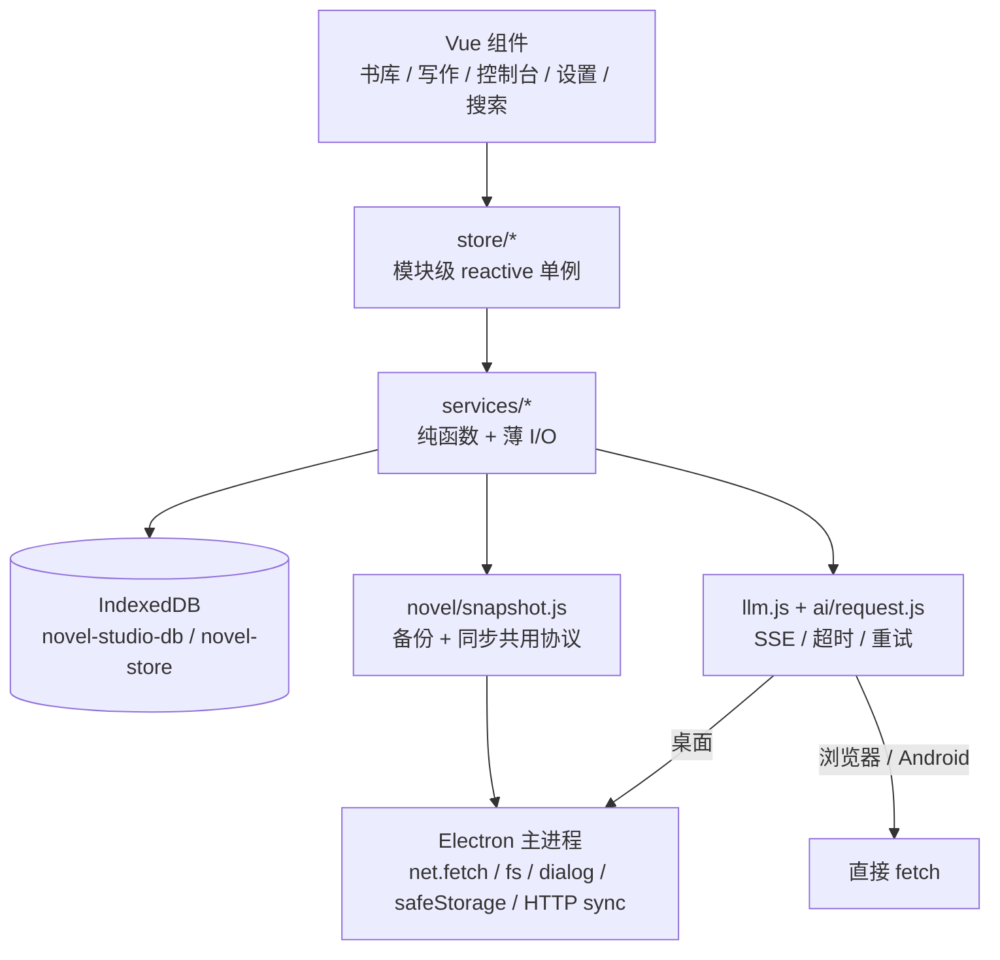
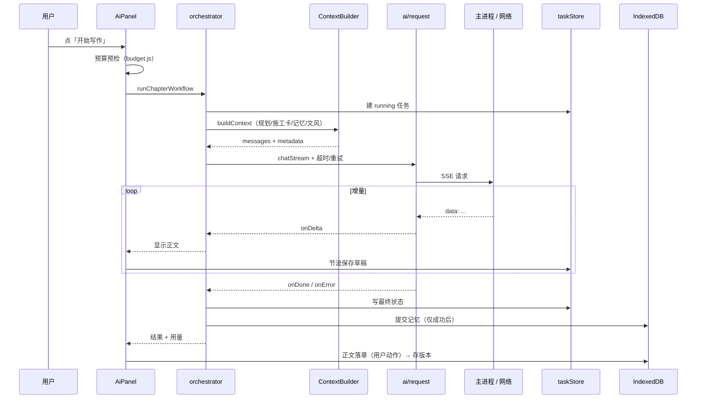

# Novel Studio V3 升级审计与实施报告

> 依据：仓库根目录 `Novel_Studio_软件升级总控实施规范_V1.0.md`，以及 `docs/01`–`06` 的 V2 规格书。
> 目标版本：**3.0.0**。实施日期：2026-10。
> 原则：每个阶段独立可构建、可测试；不破坏 V1/V2 数据与交互；不引入新的运行时依赖。

## 1. 结论摘要

V3 的主线是 **先保证稿子不丢，再谈写得更好**。本轮完成了规范中的 P0 / P1 / P2 全部条目：

| 级别 | 事项 | 状态 |
|---|---|---|
| P0 | 自动保存失败可见与重试、退出/切后台冲刷、流式草稿崩溃恢复 | 已落地 |
| P0 | 备份校验和、版本校验、恢复前留底、副本导入、迁移保护 | 已落地 |
| P0 | 接口错误分类、空闲超时、有限重试与退避、截断检测、密钥脱敏 | 已落地 |
| P0 | Windows 版 API Key 使用 Electron `safeStorage` 加密 | 已落地 |
| P0 | 同步正文冲突保留副本，不静默覆盖 | 已落地 |
| P1 | 全书规划 / 卷篇施工卡 / 场景 / 锁定节点与提案 | 已落地 |
| P1 | 记忆来源证据、变更日志与撤销、低风险批量确认 | 已落地 |
| P1 | 审校问题生命周期、定向修复、复核、版本差异 | 已落地 |
| P2 | 按任务分模型、文风档案、统计、花费预算、全书搜索、分页 | 已落地 |
| 测试 | `npm test` 单测、CI 执行单测、冒烟扩展到 180 项 | 已落地 |

## 2. 审计发现（改造前）

改造前的真实缺口，按「静默丢失 / 阻断长篇写作 / 体验」排序：

1. **自动保存只有两态**。写入失败时界面永远停在「保存中」，用户以为已保存。
2. **防抖窗口不冲刷**。切后台、关窗、Android 杀后台时，最后 1.5 秒内的文字丢失。
3. **流式正文只在内存**。长章生成数分钟，期间崩溃或关窗，已计费的输出全部消失。
4. **备份无完整性校验**。文件被截断或手改后仍可能部分写库，且恢复前没有留底。
5. **迁移无失败报告**。部分失败后重跑的边界不清晰。
6. **LLM 错误不可执行**。所有失败都是一句原始错误；429/5xx 不重试，超时无上限。
7. **API Key 明文存放在 IndexedDB**（桌面端）。
8. **同步后写者赢**。同一章两端都改过时，一方的正文被静默覆盖。
9. **规划层断裂**：`arcs.volumeId` 缺失导致卷层上下文实际从未注入；无全书规划与章节施工卡。
10. **审校只读**：问题不能标记、不能定向修复、报告与版本没有关联。
11. **版本只能看全文**：没有两版对比，误删恢复之外没有「以此为草稿」。
12. **生成记录不足以复盘**：没有提示词版本、上下文摘要、实际模型与参数。
13. **无按任务分模型、文风、统计、预算、全书搜索**；大列表一次渲染全部。

## 3. 架构

### 3.1 分层

不变的边界：渲染层不碰 `fs` / `shell` / `dialog` / `safeStorage`；`contextIsolation: true`、
`nodeIntegration: false`、`webSecurity: true` 全部保持原状；所有写库仍经 `storage.js` 的
`serialize` + `toPlain` + `!bookId` 守卫。

### 3.2 一次生成的数据流

## 4. 阶段落地

### 阶段 1（P0）：数据安全

| 能力 | 实现位置 | 关键约束 |
|---|---|---|
| 自动保存状态机 | `services/autosave.js`、`Editor.vue` | 目标章 id 在 `schedule()` 捕获；失败可重试；不引入第二个写者 |
| 生命周期冲刷 | `App.vue`、`native.js`、`electron/main.js` | `pagehide`/`visibilitychange`/失焦/Android 后台；关窗握手 `app:before-close` → `app:close-ready` |
| 流式草稿 | `services/ai/taskStore.js`、`AiPanel.vue` | 1.5 秒或 800 字节节流；`running` 永不裁剪；只恢复已收到内容 |
| 备份完整性 | `novel/snapshot.js`、`BackupModal.vue` | FNV-1a 校验和；旧文件无校验和仍可读；恢复前留底；副本导入 |
| 迁移保护 | `services/migration.js` | schemaVersion 3；不改写旧记录；写数据前先留底；失败可重跑 |

### 阶段 2（P0）：接口稳定性与密钥

- `ai/errors.js`：`network / auth / bad-request / not-found / timeout / rate-limit / server / truncated / parse / aborted` 分类，文案可执行，`redactSecrets` 兜底。
- `ai/request.js`：空闲超时（默认 60 秒）、最多 2 次退避重试（指数 + 抖动 + `Retry-After`）、**收到正文后不再自动重试**。
- `llm.js` 的 `onError` 改为对象；`finish_reason === 'length'` 标为截断。
- `secret.js` + `secret:*` IPC + safeStorage；迁移顺序是「加密写成功 → 清除 IndexedDB 明文」。

### 阶段 3（P0/P1）：同步冲突、上下文、记忆

- `sync/conflicts.js`：首次同步只建基线；同章双改且都晚于基线才判冲突；副本 id 确定性；`syncConflicts` 随合并结果传播。
- Context Builder 增加输出预留、来源与原因标注、pending/rumor 过滤、冲突标注。
- 记忆实体追加来源、证据、事实层级、置信度、确认状态、不可变标记；`memoryChangeLog` 支持撤销（当前值仍等于变更后值时才回滚）。
- 生成记录保存 `taskId / promptVersion / params / contextSummary / error / finishReason / attempts`。

### 阶段 4（P1）：规划、审校闭环、版本差异

- 全书规划（`books.plan`）、卷 / 篇 / 章施工卡、场景（`scenes`）、锁定节点与提案（`planProposals`）。
- 新增 `planCheck.js`：确定性核对目标字数、必发事件、禁发内容、验收关键词；不产生费用。
- 审校问题契约升级；`reviewIssueStates` 只存状态与 `contentHash`；新增 `fix` 阶段，先预览差异、用户接受才写回并留 `review` 版本。
- `diff.js` 行级 LCS；版本面板支持两版对比与「复制为草稿」。

### 阶段 5（P2）：多模型、文风、统计、预算、搜索、性能

- `ai/models.js`：`write / extract / review / plan / outline` 五个任务键，空值回退统一模型。
- `novel/style.js` + `styleProfiles` 集合：压缩为一层注入，样本最多 300 字。
- `novel/stats.js` + 控制台「统计」：完成度、字数、主线/支线、人物出场、伏笔回收、事件密度；每项标注口径。
- `ai/budget.js`：单次/每日上限、`warn/confirm`；未知价格返回 `null`，不显示 ¥0。
- `novel/retrieval.js` + `SearchModal.vue`：章节、旧设定、结构化实体统一搜索；键盘导航；安全片段渲染。
- `composables/usePagedList.js`：章节 / 实体 / 版本 / 历史 / 时间线每页 100 条。
- 可访问性：`:focus-visible` 统一焦点环、图标按钮 `aria-label`、触控目标 ≥40px（既有）。

## 5. 数据模型与迁移

### 5.1 集合

`storage.js` 的 `COLLECTIONS` 是唯一事实来源。V3 新增：`generationTasks`、`memoryChangeLog`、
`syncConflicts`、`scenes`、`planProposals`、`reviewIssueStates`、`styleProfiles`。
`snapshot.js` 的 `DATA_COLLECTIONS` 由它派生，并显式排除 `tombstones`（单独处理）与
`generationTasks`（设备本地草稿，不应同步）。

### 5.2 版本

- `SCHEMA_VERSION`：2 → **3**。新字段全部可选，升级不重写旧记录；旧备份仍可恢复。
- `SNAPSHOT_VERSION`：保持 **1**。`appVersion / counts / checksum / deviceId` 都是可选头字段。
- 同步要求两端 `schemaVersion` 相同；不一致明确拒绝并提示升级。

### 5.3 迁移步骤

1. 启动时只写 `meta.schemaVersion` 与 `meta.migrations` 报告（无数据改写）。
2. V1 → V2 的旧设定转换仍需在控制台手动点击；迁移前自动落 `preMigrationSnapshot`。
3. 迁移逐条报告 `{ migrated, created, failed }`，失败可重跑（源行 `migratedTo` + 规范化标题双重幂等）。
4. 任何一步失败都停止后续迁移，不继续写入。

## 6. 测试矩阵

### 6.1 单元测试（`npm test`）

Node 内置 `node:test`，共 **18 个文件、156 项**，不依赖 IndexedDB / Electron：

| 文件 | 覆盖 |
|---|---|
| `autosave.test.mjs` | 状态序列、失败重试、目标不串 |
| `errors.test.mjs` | 分类、可重试判定、`Retry-After`、脱敏 |
| `request.test.mjs` | 空内容重试、部分内容不重试、中止、退避序列 |
| `taskStore.test.mjs` | 状态转换、可恢复判定、裁剪 |
| `snapshot.test.mjs` | 校验和、篡改拒绝、版本拒绝、副本重映射 |
| `conflicts.test.mjs` | 冲突检测、首次同步不误报、确定性 id、幂等 |
| `contextBuilder.test.mjs` | 输出预留、来源、冲突标注、pending 过滤 |
| `memory.test.mjs` | 证据、变更日志、撤销条件 |
| `models.test.mjs` | 默认对象、规范化、阶段回退、不改模块级设置 |
| `budget.test.mjs` | 日切、未知价格 `null`、单次/每日决策 |
| `style.test.mjs` | 启用选择、空字段省略、300 字截取、关闭开关 |
| `stats.test.mjs` | 字数口径、卷篇进度、人物去重、伏笔分母、密度 |
| `retrieval.test.mjs` | 相关性、事件关联、片段、搜索排序、反向查找 |
| `planCheck.test.mjs` | 目标字数、必发、禁发、验收 |
| `planning.test.mjs` | 锁定节拍、提案幂等 |
| `reviewIssues.test.mjs` | 状态、确定性 id、过期判定 |
| `healthRules.test.mjs` | 新增健康规则与「干净数据 0 条」 |
| `diff.test.mjs` | 等/增/删、中文、统计 |

### 6.2 Electron 冒烟（`SMOKE_TEST=1 npx electron .`）

共 **180 项断言**，扁平 `out` 对象、`out.pass` 取 AND。覆盖的关键集成路径：

- 自动保存失败与重试、`pagehide` 冲刷、关书守卫；
- 崩溃任务恢复条、载入到输出框；
- safeStorage 密钥迁移与读取、持久化设置不含明文；
- 备份校验和、恢复前快照键、副本导入、排除生成任务；
- 版本四类来源、裁剪无墓碑、回滚可撤销、删章可恢复、两版对比；
- 施工卡、锁定提案、AI 计划草案、修复草案不自动覆盖、接受后落版本；
- 时间线两种排序、一致性规则（含干净数据 0 条）、审校报告不完整落库；
- 全书搜索：章节命中 + `<mark>`、Enter 切章、实体跳转到「时间线」标签；
- 同步 HTTP 契约（预检/鉴权/冷却/体积/路由/schema 拒绝/停止）与一次真实合并往返（含冲突副本与幂等）；
- 真实点击路径的组件挂载，并断言没有运行时错误被 Vue 静默吞掉。

### 6.3 CI

`.github/workflows/release.yml` 的 windows 与 android job 都在构建前执行 `npm test`。
Electron 冒烟不纳入 CI（需要 GUI 会话、且会读写开发机真实数据库），作为发版前手工验收。

## 7. 本机验收记录

| 命令 | 实际结果 |
|---|---|
| `npm test` | **156 / 156 通过**（`fail 0`，约 0.5 秒） |
| `npm run build` | **通过**，119 个模块，产物约 389 kB（JS）/ 54 kB（CSS） |
| `SMOKE_TEST=1 npx electron .` | **`pass: true`，`assertionCount: 180`** |
| `npm run dist:win:dir` | **通过**（exit 0）；`app.asar` 18 个条目、544 KB，无 `node_modules` |
| 启动 `release/win-unpacked/Novel Studio.exe` | **进程正常启动**（主进程 + 渲染进程共 4 个），随后人工关闭；未做界面操作回归 |
| `npx cap sync android` | **通过**，复制 `dist/` 并识别 5 个 Capacitor 插件（app / clipboard / filesystem / share / status-bar） |
| `gradlew assembleDebug --no-daemon` | **BUILD SUCCESSFUL in 1m 59s**（244 tasks，33 executed） |
| APK 元信息（`aapt dump badging`） | `com.novelstudio.app`，`versionCode=4`，`versionName=3.0.0`，`minSdk=24`，`targetSdk=36`，4.45 MB |

> 打包只验证了「能启动」，不代表完整界面回归；Android 只验证到「能构建出 APK」，
> 运行时行为（窄屏、软键盘、返回键、分享、同步）仍未验证——本机没有模拟器，
> 冒烟测试是 Electron 专属。不把「构建成功」当成「运行正常」。

## 8. 已知限制

1. **浏览器 / Android 的 API Key 仍是明文**：平台没有与 safeStorage 对等的加密存储。界面已如实提示；桌面端有加密。
2. **Android 运行时行为无法在本机验证**：没有模拟器，冒烟测试是 Electron 专属。窄屏、软键盘、返回键、分享导出只能装到真机验证。
3. **同步只在局域网可达**，不做端口映射；手机端明文 HTTP 只对 debug APK 生效，release 需另配 `networkSecurityConfig`。
4. **同步按 schemaVersion 严格对齐**：不同版本会被拒绝，这是刻意的安全边界，不是 bug。
5. **统计是描述不是评价**：数字只反映本机数据，不能代表文学质量。
6. **AI 审校与计划仍会产生费用**：只有确定性规则与 `planCheck` 免费；任何 AI 调用都计入生成历史。
7. **冲突副本只覆盖章节正文**：实体仍按 LWW 合并；实体冲突目前没有副本机制。

## 9. 回滚

- 每个能力都是独立模块 / 独立集合，关闭入口即可回退，不涉及数据格式降级：
  - 同步冲突副本：设置 `syncConflictCopies=false`（回到 LWW）。
  - 审校闭环：不点「定向修复」即保持只读。
  - 计划 / 施工卡：不填字段即回到 V2 行为（Context Builder 跳过空层）。
  - 草稿恢复：删除 `generationTasks:{bookId}` 即可清空本地草稿。
- 整库回退用「全量备份 → 恢复」；恢复前系统会保留一份 `preRestoreSnapshot`。
- 建议发版前在书库页导出一次全量备份，并保存到仓库之外的位置。
