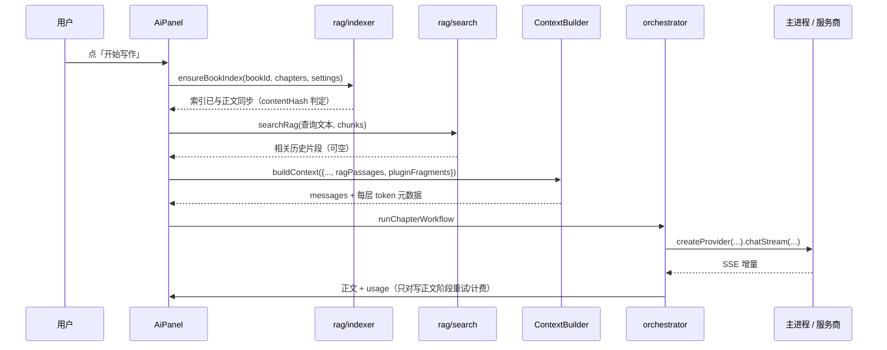

# Novel Studio V4 升级审计与实施报告

> 依据：`NovelStudio_V2_Spec/`（与 `docs/01`–`06` 逐字节相同）的 P2 条目，以及 V3 报告中列出的遗留缺口。
> 目标版本：**4.0.0**（`SCHEMA_VERSION` / `SNAPSHOT_VERSION` 不变，见第 4 节）。实施日期：2026-10。
> 原则：本地优先、先保证不丢稿、三端同一套渲染代码、**零新运行时依赖**、旧数据零迁移。

## 1. 结论摘要

V4 的主线是**把规格书里列为 P2、但 V3 尚缺的能力真正做出来**，并且每一项都有可回滚的边界。

| 阶段 | 事项 | 状态 |
|---|---|---|
| 0 | 基础设施：新集合、书指针、命名密钥槽、本地态排除、设备名 | 已落地 |
| 1 | Provider 抽象与八种预设（DeepSeek / OpenAI / Kimi / GLM / 通义 / SiliconFlow / Ollama / 自定义） | 已落地 |
| 2 | 当前章节 / 卷 / 篇指针，独立时间戳合并 | 已落地 |
| 3 | 生成前计划校验（七类确定性检查，可显式覆盖） | 已落地 |
| 4 | 持久化写作队列（逐章出草稿，不自动改正文） | 已落地 |
| 5 | 本地哈希 Embedding + RAG（256 维、无依赖、默认关） | 已落地 |
| 6 | 人物关系图（手写 SVG，纯派生，不写库） | 已落地 |
| 7 | WebDAV 多设备同步（用户自建服务器，ETag + 冲突副本） | 已落地 |
| 8 | 声明式插件（只读 JSON 声明，**绝不执行插件代码**） | 已落地 |
| 9 | 真实截图（7 张 1440×900）与文档更新 | 已落地 |
| 10 | Android **签名 release APK**（本机新 keystore，允许明文 HTTP） | 已落地 |

本机实测（2026-10-24）：

| 验证项 | 结果 |
|---|---|
| `npm test` | **276 / 276 通过**，约 0.6 秒 |
| `npm run build` | 通过（vite，约 119 个 chunk） |
| `SMOKE_TEST=1 npx electron .` | `SMOKE_MOUNT` 正常；`SMOKE_DETAIL.pass = true`，**232 项断言** |
| `npm run screenshots` | 7 张 PNG，均为 1440×900 |
| `npm run screenshots:check` | 7 张全部通过（魔数 / 尺寸 / 体积） |
| `npm run dist:win:dir` | 通过，并实际启动 `win-unpacked/Novel Studio.exe` |
| `gradlew assembleDebug assembleRelease` | 通过（见第 8 节） |
| `apksigner verify --print-certs` | 通过，release APK 已签名 |

## 2. 审计发现（V3 之后仍缺什么）

对照规格书与本仓库 V3 报告，V4 开始前的真实缺口：

1. **只有一个隐式的接口配置**。用户知道 Base URL，却不知道 OpenAI 兼容端点该填什么；切换服务商要靠查文档。
2. **打开一本书总是回到第一章**。长篇写到第 300 章，每次重开都要自己翻回去。
3. **AI 计划没有任何前置校验**。死亡人物被写活、覆灭势力复活、伏笔提前揭示，只能等写完之后靠一致性检查发现。
4. **只能一次生成一章**。批量补草稿要人守着逐章点按钮，中途关掉面板就没有任何记录。
5. **AI 只能看到最近几章**。几十万字之后，早先埋下的细节彻底消失在上下文之外。
6. **人物关系只存在于自由文本里**。谁属于哪个势力、和谁对立，无法一眼看全。
7. **跨网络（不在同一局域网）没有同步手段**。局域网同步要求两台设备在同一 Wi-Fi。
8. **没有任何扩展机制**。作者自己的禁用词表、格式模板、写作规矩只能靠手写进每章的临时要求。
9. **README 里没有截图**，用户不知道界面长什么样。
10. **只有 debug APK**，release 需要签名与明文 HTTP 配置，此前被列为「范围外」。

## 3. 架构

### 3.1 新增模块的位置

```
src/services/
├── ai/
│   ├── providers.js      # 八种预设 + createProvider（chatStream / chat / countTokens）
│   ├── queue.js          # 队列条目状态机（纯函数）
│   └── queueRunner.js     # 全局串行执行器（可注入 runItem / flush）
├── novel/
│   ├── pointers.js       # 书指针推导、删章回退、独立合并键
│   ├── planValidate.js   # 七类计划校验（纯函数，不调用模型）
│   └── graph.js          # 关系图构建、关系文本解析、确定性布局
├── rag/
│   ├── hashEmbedding.js  # FNV-1a 哈希 → 256 维计数向量、IDF、余弦
│   ├── chunking.js       # 段落优先切块（约 500 字，80 字重叠）
│   ├── search.js         # 查询时分块打分（topK / minScore / 每章上限）
│   ├── indexer.js        # 按 contentHash 增量重建、清除、状态
│   └── context.js        # 查询文本构造、检索入口（异常返回空）
├── sync/
│   ├── webdav.js         # 渲染层：拉取 → 合并 → ETag 上传
│   └── webdavConfig.js   # 地址/路径/状态码/ETag 规范（纯函数）
├── plugins/
│   ├── manifest.js       # 清单校验与限流（纯函数）
│   └── hooks.js          # 四个 hook 的纯函数实现
└── settingsExtras.js     # 对象型设置默认值与 normalize
```

主进程新增 `electron/webdav.js`（唯一发出 WebDAV 请求的地方）与 `plugins:list` / `plugins:openFolder` 两个 IPC 通道。

### 3.2 一次「带检索与插件」的生成



**Context Builder 仍然是纯函数**：RAG 片段与插件碎片都由调用方算好再传进来，它只做分层与预算。这样它能被单测逐字钉死，也不会在渲染之外（如 Node 测试）碰到 IndexedDB。

### 3.3 队列与同步的互斥

`generationStore.running` 仍是「是否正在生成」的唯一真相。队列运行时会置位它，因此：

- 局域网同步返回 `409`；
- WebDAV 同步返回 `{ok:true, skipped:'busy'}`（不报错）；
- 生成中的章节不会被自动保存与整组回写互相覆盖。

队列**只跑 `['write']` 阶段**，成功即 `done`，**绝不自动写章节**。用户点「插入」时才走既有的 `addChapterWithContent` / `captureChapterVersion` / `applyChapterMeta`。若 `autoExtractMemory` 为真，插入后再单独跑一次 `['extract']`——这是一次真实计费调用，界面明示。

## 4. 数据与版本政策

- `SCHEMA_VERSION` 保持 **3**，`SNAPSHOT_VERSION` 保持 **1**，**没有写任何数据迁移**。
- 新增字段全部可选；旧客户端合并记录时保留未知字段。
- 新增集合进 `COLLECTIONS`（获得 `serialize` / `toPlain` / `!bookId` 守卫 / 级联删除）：

| 集合 | 是否进快照 | 理由 |
|---|---|---|
| `generationQueue` | **否** | 记录的是「这台机器上排队等生成的草稿」，同步到另一台毫无意义 |
| `ragChunks` | **否** | 向量由本机算法与内容哈希生成，换机后自动重建 |

`snapshot.js` 的 `LOCAL_ONLY_COLLECTIONS = ['generationTasks', 'generationQueue', 'ragChunks']` 是排除清单的唯一事实来源。

- 新增根键 `generationQueueState`（暂停标记）同样只在本地。
- 书新增可选指针：`currentVolumeId` / `currentArcId` / `currentChapterId` / `currentPointerUpdatedAt`。
- 章节新增可选 `lastEditedBy` / `lastEditedByName` / `lastEditedAt`（只在 `persistChapter` 打戳，`saveAll` / `applySnapshot` 不打）。
- 快照头新增可选 `deviceName`，**不进校验和**（校验和仍只覆盖 books / data / bookTombstones）。

新增设置键（均由 `settingsExtras.js` 的 normalizer 补齐；`settings.load()` 是浅合并，对象型设置必须 normalize）：

| 键 | 默认 | 说明 |
|---|---|---|
| `providerId` | `'deepseek'` | 只影响预设填充与展示，凭据仍是 `baseUrl` + `model` |
| `deviceName` | `''` | 空时由 `deviceId` 派生「设备 xxxx」 |
| `planValidation` | `{enabled:true, blockHigh:true, repetitionWindow:3}` | 计划校验开关与重复窗口 |
| `rag` | `{enabled:false, topK:6, minScore:0.18, budget:800, chunkChars:500, overlapChars:80}` | **默认关**，避免悄悄改变提示词 |
| `webdav` | `{enabled:false, url:'', username:'', remoteDir:'novel-studio', autoSync:false, intervalSec:300, conflictCopies:true, timeoutSec:30, lastSyncAt:0, lastStatus:'idle', lastError:'', lastEtag:''}` | 密码不在其中（safeStorage 的 `webdavPassword` 槽） |
| `plugins` | `{enabled:true, disabledIds:[], contextBudget:400}` | 仅桌面端读取插件目录 |

## 5. 各阶段落地位置

### 阶段 0 · 基础设施

- `storage.js`：`COLLECTIONS` 追加 `generationQueue` / `ragChunks`；新增 `patchBook(bookId, patch)`（在 `serialize('books')` 内读-改-写，只写指针四字段，**不改 `book.updatedAt`**）、`getQueueState` / `saveQueueState`。
- `snapshot.js`：`LOCAL_ONLY_COLLECTIONS` 排除本地态；`deviceName` 头字段；`mergeBookRecords` 让指针按 `currentPointerUpdatedAt` 独立选择。
- `secret.js` + `electron/main.js` + `preload.js`：`secret:*` 支持命名槽，文件分别为 `secure/api-key.bin` 与 `secure/webdav-password.bin`；未知槽返回 `EINVAL`，**绝不回退明文**。

### 阶段 1 · Provider

`providers.js` 的 `createProvider({ settings, stage, chat, estimator })` 返回 Stream 与收集器两种形态；`chatStream` 仍委托 `chatStreamReliable`，所以超时、重试、截断、脱敏的契约一字未改。

- 切换预设**不覆盖**用户已填的 API Key；
- Ollama 允许空 Key；
- 自定义地址不匹配任何预设时显示「自定义」，`inferProviderId` 只在用户没选过时才推断。

### 阶段 2 · 书指针

`pointers.js` 全部是纯函数；`books.js` 在 `openBook` 恢复指针、`selectChapter` 立即更新内存并 600ms 防抖写回、`flushCurrentPointers()` 在 `closeBook` / 回书库 / 同步重载前收口，`removeChapter` 按「原位置 → 前一章 → 后一章 → null」回退。

**指针不 bump `book.updatedAt`**：否则每次翻页都会让整本书在同步时「看起来更新了」。

### 阶段 3 · 计划校验

`planValidate.js` 的七类检查只做字面匹配，复用 `splitPlanTerms` / `matchesTerm`，不调用模型：

1. 已死亡人物出场 / POV 已死；2. 覆灭势力出场；3. 时间线倒挂或提前引用未发生事件；4. 核心世界规则被改写；5. 伏笔提前揭示；6. 偏离当前卷/篇必发节拍；7. 与最近 N 章高度重复（bigram Dice ≥ 0.6）。

- 每条 issue 都带 `evidence`（指回原文），避免「看起来像 AI 在挑刺」。
- 校验失败**不让阶段失败**；`shouldBlockPlan` 只影响「AI 草案自动采用 / 队列自动继续」，**永不阻断用户手工编辑**，high 可显式覆盖。
- 空草稿、空数据必须 0 条（单测与冒烟各有一组反向断言）。

### 阶段 4 · 写作队列

`queue.js` 显式列出状态迁移；`queueRunner.js` 全局串行；`writingQueue.js` 是模块级 reactive 单例；`QueuePanel.vue` 从侧栏「队列」进入。

关键语义：

- 同一章只允许一条 `queued` / `running`；
- 入队与每项开始前 `ui.flush()`；执行前校验章节仍存在；
- 重启后 `running → interrupted`，**不自动重跑**；队列默认暂停，用户点「继续」才继续；
- 结果文本上限 200,000 字；失败保留已收到的文本；
- 每项结束后核对当日花费，超预算则暂停队列并提示；
- 删除章节/书籍时条目失败或被级联删除。

### 阶段 5 · 本地哈希 Embedding + RAG

- `embedText` 用 FNV-1a 把中文单字、双字 n-gram 与拉丁词散列到 **256 维**计数向量；**确定性、无随机数、无依赖**。
- **IDF 在查询时按当前书全部 chunk 现算**，避免增量章节导致新旧向量权重空间不一致。
- 分块段落优先、长段按句切，保留下标 `start/end`；内容哈希变化或章节删除才重建，整组 `saveAll` 回写，**不写墓碑**。
- 检索层 `ragPassages`（priority 11、非必需、保留头部、预算取 `settings.rag.budget`）；无片段时不产生层，提示词与旧版逐字一致。
- 检索异常一律返回空数组——检索坏掉不该让写作失败。
- 控制台「检索」标签（`RagPanel.vue`）显示覆盖率、chunk 数、重建/清除与查询试跑；文案明确「字面相似检索，不是语义模型」。

### 阶段 6 · 关系图

`graph.js` 从人物、势力、事件、伏笔、章节派生节点与边；节点上限 80、边上限 400；悬空引用丢弃；布局无随机数，同输入同输出。`RelationshipGraph.vue` 是手写 SVG + CSS，不引入图表库。

关系文本解析刻意保守：只认「恰好两个已知人物名 + 明确分隔符」的行，其余留给用户自己看。

### 阶段 7 · WebDAV

- 文件布局：`<remoteDir>/<deviceId>.json`；PROPFIND 列出其他设备文件。
- 流程：`flush` → 生成快照 → 逐个对端调用**既有的** `handleIncomingSnapshot`（复用冲突副本、基线、墓碑合并）→ 统一 `reloadAfterSync` + `reloadEditor` → 上传合并结果。
- 有 `lastEtag` 时带 `If-Match`；`412` 重新拉取并合并，最多重试 2 次；服务器无 ETag 时上传并提示无法完全防止并发覆盖。
- 只做 LWW + 冲突副本，**不做 CRDT / 实时共编 / LOCK**。
- 安全：只允许 `http/https` 且与配置的 `baseUrl` 同源；路径拒绝 `..`；方法白名单 `PROPFIND/MKCOL/GET/HEAD/PUT`；请求与响应上限 64 MB；`redirect:'manual'`；**请求只在主进程**，密码从 `webdavPassword` 槽读，**不打任何含密码或 Authorization 的日志**。

### 阶段 8 · 声明式插件

- 位置：`userData/plugins/*.json`，单文件 ≤256 KB、最多 100 个；坏文件只标记，不影响其他插件。
- `validatePluginManifest`：id 正则、四个 hook 白名单、数量与长度上限、正则预编译、flags 仅 `gimsuy`、**拒绝匹配空字符串的正则**。
- 四个 hook 全部是纯函数：
  - `contextFragments` → 一层 `pluginContext`（priority 5、预算 `plugins.contextBudget`），**整条碎片要么进要么不进**，绝不截断；
  - `rules` → 并入一致性报告（`source:'plugin'`）；输入截断 200k 字、每章最多 20 条、总命中上限 999；
  - `exportTemplates` → 纯字符串占位符替换，未知占位符原样保留；
  - `keywordHints` → 最多 10 条提示，**不自动进提示词**。
- 界面（`PluginsPanel.vue`）明示：「本软件只读取这些声明，绝不执行插件代码」；并提示复杂正则会拖慢应用（ReDoS 无法根除，只能限流）。

### 阶段 9 · 截图与文档

- `scripts/screenshot-fixtures.cjs`：纯虚构数据（2 本书、15 章、人物/势力/地点/规则/事件/伏笔/文风/生成记录），`apiKey:''`。
- `scripts/capture-screenshots.cjs`：**在 `app.whenReady` 之前**把 `userData` / `sessionData` / `logs` 指到 `os.tmpdir()` 下的 `novel-studio-shots-*`；断言目录名；注册只读 IPC 桩；加载 `dist/index.html`；固定 1440×900；截图前断言无 API Key、无 WebDAV 密码、页面无 `sk-` 形态字符串；结束删除临时目录。
- `scripts/check-screenshots.cjs`：7 张图存在、PNG 魔数、1440×900、>20KB。
- 本文档与 README / CLAUDE.md / RELEASE_NOTES 同步更新。

## 6. 测试矩阵

### 单元测试（`npm test`，276 项）

| 文件 | 项数 | 覆盖 |
|---|---:|---|
| `autosave` | 7 | 防抖、冲刷、失败重试、不串目标 |
| `budget` | 6 | 单次/每日上限、未知价格不等于 ¥0 |
| `conflicts` | 12 | 冲突判定、确定性副本 id、首次同步基线 |
| `contextBuilder` | 16 | 分层预算、丢弃、去重、ragPassages 层 |
| `diff` | 7 | 行/段落 LCS |
| `errors` | 11 | 分类、脱敏、Retry-After |
| `graph` | 9 | 节点/边、共现、保守文本解析、无悬空、布局确定性 |
| `healthRules` | 8 | 一致性规则与干净数据 0 条 |
| `memory` | 10 | 变更日志、撤销 |
| `models` | 4 | 按任务分模型回退 |
| `planCheck` | 7 | 施工卡确定性检查 |
| `planValidate` | 14 | 七类检查、覆盖、空数据 0 条 |
| `planning` | 5 | 锁定节点与提案 |
| `plugins` | 34 | 清单校验、正则拒绝、四个 hook、模板占位符 |
| `pointers` | 6 | 推导、删章回退、独立合并 |
| `providers` | 8 | 预设、URL 推断、Key 不覆盖、Ollama 空 Key、流收集 |
| `queue` | 16 | 状态迁移、恢复、无自动重试、文本上限、重复入队 |
| `rag` | 10 | 维度/确定性、切块、IDF、自章排除、预算截断 |
| `request` | 13 | 重试集合、退避、已收到正文不重试 |
| `retrieval` | 9 | 全书搜索与反向查找 |
| `reviewIssues` | 6 | 问题状态与 contentHash 过期 |
| `settingsExtras` | 6 | 对象型设置补齐与边界 |
| `snapshot` | 17 | 校验和、本地态排除、指针独立合并、副本重映射 |
| `stats` | 7 | 统计口径 |
| `style` | 5 | 文风注入 |
| `taskStore` | 11 | 草稿节流与恢复 |
| `webdav` | 13 | 路径穿越拒绝、方法白名单、ETag 重试、状态分类 |

### Electron 冒烟（232 项断言）

V4 新增并全部进入 `out.pass` 的 AND 链：

- 书指针：`pointerDeriveOk` / `pointerPersistOk` / `pointerKeepsBookUpdatedAtOk` / `pointerRestoreOnOpenOk` / `pointerSurvivesSyncReloadOk` / `pointerFallbackAfterDeleteOk`
- 计划校验：`planValidateWiredIntoStagePlanOk` / `planValidateBlockSaveOk` / `planValidateOverrideSavesOk`
- 队列：`queueEnqueuePersistOk` / `queueBlocksSyncOk` / `queueSerialRunOk` / `queueNoAutoWriteOk` / `queueResultInsertOk` / `queueFailureKeepsTextOk` / `queueRecoveryOk` / `queuePanelMountOk`
- RAG：`ragIndexChapterOk` / `ragIncrementalReplaceOk` / `ragDeleteChapterCleanupOk` / `ragLayerInContextOk` / `ragDisabledNoLayerOk` / `consoleRagPanelOk`
- 关系图：`graphCharacterNodesOk` / `graphFactionLeaderEdgeOk` / `graphEventCooccurrenceOk` / `graphTextRelationshipConservativeOk` / `graphNoDanglingEdgesOk` / `graphLayoutDeterministicOk` / `graphTabBadgeOk` / `graphRenderOk` / `graphFilterOk` / `graphClickDetailOk`
- WebDAV：`webdavPanelOk` / `webdavMockAvailableOk` / `webdavMockConnectOk` / `webdavMockUploadOk` / `webdavMockPullMergeOk` / `webdavMockEtagConflictRetryOk` / `webdavBusyRejectedOk` / `webdavSecretNotInSnapshotOk` / `webdavStateLabelOk`
- 插件：`pluginPanelOk` / `pluginListIsolationOk` / `pluginStoreLoadOk` / `pluginContextLayerOk` / `pluginDisabledNoLayerOk` / `pluginRuleIssueOk` / `pluginTemplateExportOk` / `pluginKeywordHintOk` / `pluginDisabledOk` / `pluginSettingsNotInSnapshotOk`

同步类断言仍从渲染进程发**真实 `fetch`**；WebDAV 段落使用主进程内的内存 Mock 服务器（PROPFIND / MKCOL / GET / HEAD / PUT + ETag）。

## 7. 已知限制

以下都是**有意的边界**，不是待办：

1. **RAG 不是语义检索**。哈希向量只捕捉字面相近（同词、同 n-gram）。同义改写、跨语言的召回很弱；它的价值是「同一个人名、地名、物件名再次出现时能捞回原文」，不是理解。界面上已如实写明。
2. **插件不执行代码**，因此不能做 AST 分析、不能自定义布局、不能联网。复杂正则仍有 ReDoS 风险，只能靠输入截断与命中上限缓解。
3. **WebDAV 不做 CRDT**。同一章两端并发编辑仍会产生冲突副本；服务器不返回 ETag 时无法完全防止并发覆盖，界面会提示。
4. **关系图是只读派生视图**。真正的关系仍以人物记录里的自由文本为准；文本解析只认保守格式，解析不出来就不画。
5. **队列不会替你决定正文**。它只产出草稿，插入、替换、丢弃都由用户确认。
6. **计划校验是提示不是拦截**。作者有权偏离自己的计划；high 问题也能显式覆盖。
7. **Android 运行时仍未验证**。本机无模拟器/真机；签名通过只说明包是完整的，不说明窄屏、软键盘、返回键、分享导出、明文 HTTP 在真机上一定正常。
8. **没有 iOS**、不做 Google Play / AAB。

## 8. Android Release 签名

- keystore：本机 `keytool` 生成（RSA 2048 / 10000 天 / alias `novelstudio`），文件在 `android/keystore/release.jks`，密码在 `android/keystore.properties`。**两者都不入库**，见 `.gitignore`。
- `android/app/build.gradle` 读取 `keystore.properties` 配置 `signingConfigs.release`；缺少签名材料时 `assembleRelease` **明确报错**，不静默产出 unsigned 包。
- `network_security_config.xml` 允许 cleartext，`AndroidManifest.xml` 引用它。这意味着 release APK 可以用 `http://` 的 LLM 端点、本机 Ollama 与局域网同步。
- CI（`.github/workflows/release.yml`）通过四个 Secrets 注入签名材料：`ANDROID_KEYSTORE_BASE64`、`ANDROID_KEYSTORE_PASSWORD`、`ANDROID_KEY_ALIAS`、`ANDROID_KEY_PASSWORD`；未配置时构建 debug 并在产物名与日志中标注「未签名」。
- 发版产物名保持纯 ASCII：`Novel-Studio-Android-<tag>-release.apk`。

**用户须知**：keystore 一旦丢失，就无法用同一包名覆盖安装升级，只能卸载重装（本地数据会丢，除非先做全量备份）。请自行备份 `release.jks` 与密码。

## 9. 回滚策略

| 阶段 | 回滚方式 | 数据影响 |
|---|---|---|
| 1 Provider | 删 `providers.js` 与设置面板下拉；`baseUrl/model` 本就是唯一凭据 | 无 |
| 2 指针 | 不再写指针字段即可；旧版忽略未知字段 | 无 |
| 3 计划校验 | `planValidation.enabled = false` | 无 |
| 4 队列 | 不使用队列；集合本身可留可删 | 草稿随队列条目存在，删条目即删草稿 |
| 5 RAG | `rag.enabled = false`；`ragChunks` 是本地态，可清空重建 | 无 |
| 6 关系图 | 删标签；完全派生，不写库 | 无 |
| 7 WebDAV | `webdav.enabled = false`；删除远程文件不影响本机 | 无（同步是合并，不是替换） |
| 8 插件 | `plugins.enabled = false` 或删除 JSON | 无 |
| 10 签名 | 换 keystore 需卸载重装 | **本机数据会丢，先备份** |

所有新增能力都遵循同一条原则：**关掉它，行为就回到 V3**。没有一项会重写既有记录的形状，也没有一项需要数据迁移。
